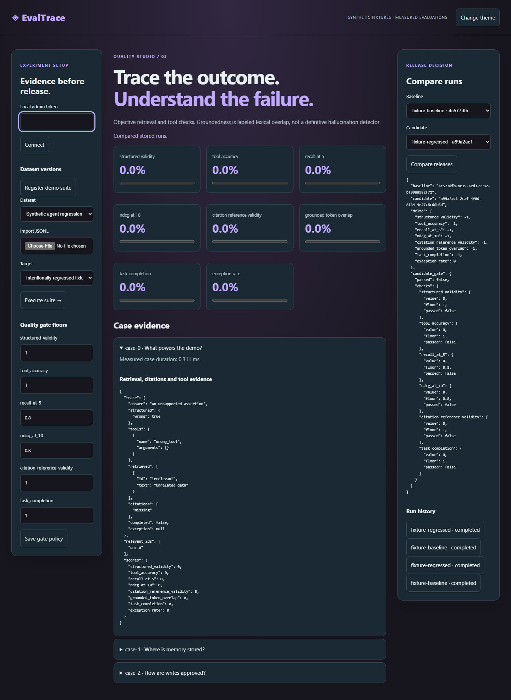
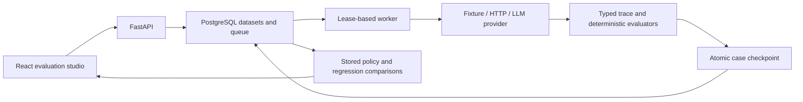

# EvalTrace

[Open live application](https://evaltrace-liart.vercel.app) · [Interactive API](https://evaltrace-liart.vercel.app/docs) · [Cloud verification](docs/CLOUD_DELIVERY.md)

Production uses Neon PostgreSQL for immutable datasets, traces, durable queues and checkpoints. Authenticated worker steps execute queued jobs within bounded requests. Groq GPT-OSS 20B is available as an evaluation target; a live target can fail quality gates without being hidden or relabeled as a passing fixture.


An original evaluation studio for versioned datasets, durable execution, typed traces and reproducible release gates.

React/TypeScript presents stored run progress, metric scorecards, baseline/candidate comparisons, failure evidence and gate-policy editing. FastAPI and PostgreSQL persist execution checkpoints; workers recover interrupted jobs using expiring leases and ownership checks. Offline fixture mode is complete without provider credentials.



## Windows quickstart

Python 3.12 and Node 22 are used. Run only one project stack at a time.

```powershell
cd K:\Projects\EvalTrace
py -3.12 -m venv .venv
.\.venv\Scripts\python.exe -m pip install -r requirements.lock
npm ci --prefix frontend
npm run build --prefix frontend
$env:ADMIN_TOKEN='choose-a-local-secret'
.\.venv\Scripts\python.exe -m uvicorn app.main:app --host 127.0.0.1 --port 8002
```

Open http://127.0.0.1:8002. Connect with the local token, register the synthetic suite, run the baseline, run the deliberately regressed target, compare releases and inspect a failed case. Native default storage is explicitly SQLite. PostgreSQL requires DATABASE_URL and `python -m alembic upgrade head`. For a continuously running worker use `python -m app.worker`; the UI also exposes an authenticated single worker step. Existing static journeys remain at `/legacy`.

## Implemented and verified

- Immutable typed datasets and JSONL import; content hashes identify versions.
- Durable queued jobs, policy snapshots, 90-second leases, worker ownership fencing and transactional per-case checkpoints.
- Normalized outputs, tools, retrieved documents, citations, metric scores and comparison records.
- JSON Schema validity, exact ordered tool correctness, Recall@5, nDCG@10, citation-reference validity, claim support, task completion and exception rate.
- Deterministic baseline/regressed fixtures, bounded loopback/HTTPS targets and an optional real LLM provider adapter.
- React dashboards, run progress, dataset inspection, release comparison, failed trace investigation, citation evidence, policy editor and responsive dark/light themes.

Real PostgreSQL testing killed a test-owned worker after one checkpoint, then recovered without duplicate cases; two concurrent workers could not own the same job. Local React and browser checks passed. Current Docker/CI evidence is in [TEST_REPORT](docs/TEST_REPORT.md). Live Groq execution is now verified separately in [Cloud delivery](docs/CLOUD_DELIVERY.md); mock transport tests remain unit tests.



## Testing and release gates

```powershell
.\.venv\Scripts\python.exe -m pytest -q tests
.\.venv\Scripts\python.exe -m pytest -q integration
npm run typecheck --prefix frontend
npm run lint --prefix frontend
npm test --prefix frontend
npm run build --prefix frontend
.\.venv\Scripts\python.exe tests/browser_journey.py
.\.venv\Scripts\python.exe -m app.cli --target fixture-baseline
.\.venv\Scripts\python.exe -m app.cli --target fixture-regressed
```

The baseline exits 0; the deliberately regressed target exits 1. That block is expected product behavior, not a failed software test. `python -m app.cli --baseline RUN_ID --candidate RUN_ID` also blocks decreases in benefit metrics, increases in exception rate, or an absolute candidate-policy failure. Integration requires an isolated real PostgreSQL TEST_DATABASE_URL and never substitutes SQLite.

Fixture baselines score 1 on the six original benefit gates; the deliberately regressed fixture scores 0. These values are calculated from the supplied traces, not production statistics. Grounding checks are lexical/numeric/negation heuristics, not definitive hallucination detection. No unobserved token usage, cost or latency is invented.

## Configuration and Docker

| Variable | Meaning |
|---|---|
| DATABASE_URL | PostgreSQL SQLAlchemy URL; default local SQLite demo |
| ADMIN_TOKEN | Required operator bearer token |
| POSTGRES_PASSWORD | Required Compose database secret |
| APP_PORT | Loopback host port, default 8002 |
| LOCAL_TARGET_URL | Loopback HTTP typed-trace endpoint |
| REMOTE_TARGET_URL / REMOTE_TARGET_TOKEN | Configured HTTPS typed-trace endpoint and optional secret |
| LLM_BASE_URL / LLM_MODEL / LLM_API_KEY | Optional HTTPS chat-completions provider |

`docker compose up --build -d --wait` starts PostgreSQL and the API. `docker compose --profile worker up -d` additionally starts a continuous worker. `docker compose down` stops the stack; omit `-v` to retain evidence. Keep secrets in the environment or ignored `.env`, never Git. The application is a single-operator local studio, not a multi-tenant identity service.

[Architecture](docs/ARCHITECTURE.md) · [Schema](docs/DATABASE_ERD.md) · [Metrics](docs/METRICS.md) · [Trace schema](docs/TRACE_SCHEMA.md) · [API](docs/API_REFERENCE.md) · [Deployment](docs/DEPLOYMENT.md) · [Resume verification](docs/RESUME_VERIFICATION.md) · [Attribution](docs/DEPENDENCIES_AND_ATTRIBUTION.md)

Destination: https://github.com/Kanishkar843/EvalTrace-. Delivery uses a feature branch preserving remote main. First-party source and designs were authored for this assignment; dependencies retain their notices. No project license is assigned without the owner's choice.

## GitHub delivery

Published branch: `feat/durable-evaluation-react`. [Review pull request](https://github.com/Kanishkar843/EvalTrace-/pull/1) · [Current CI results](https://github.com/Kanishkar843/EvalTrace-/actions). Main was not force-pushed or overwritten. Local acceptance evidence is recorded separately from GitHub checks.
