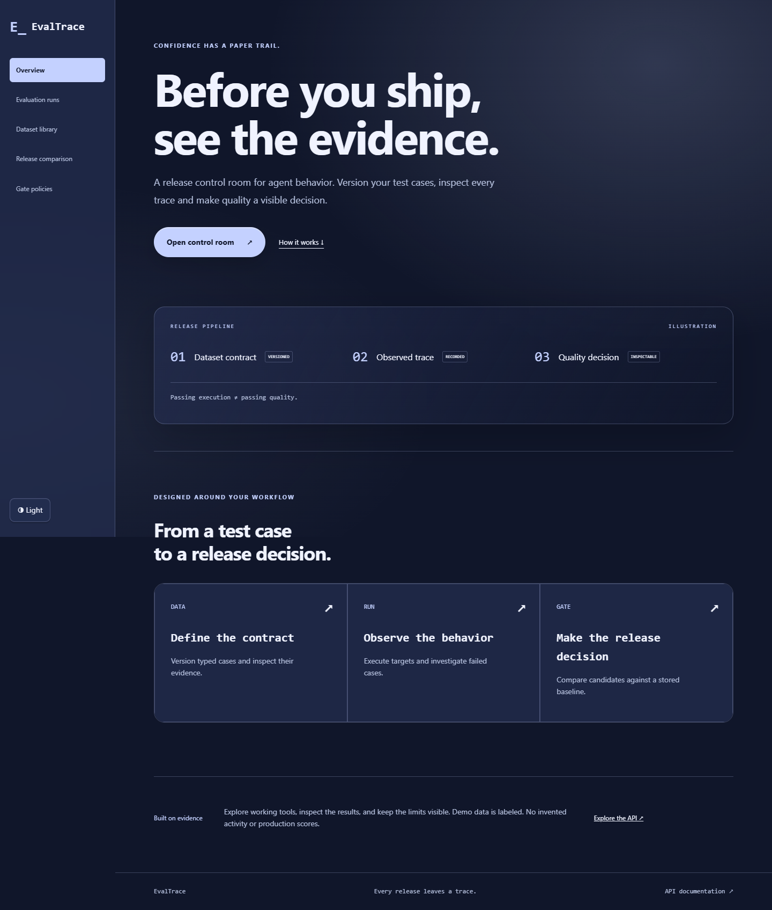
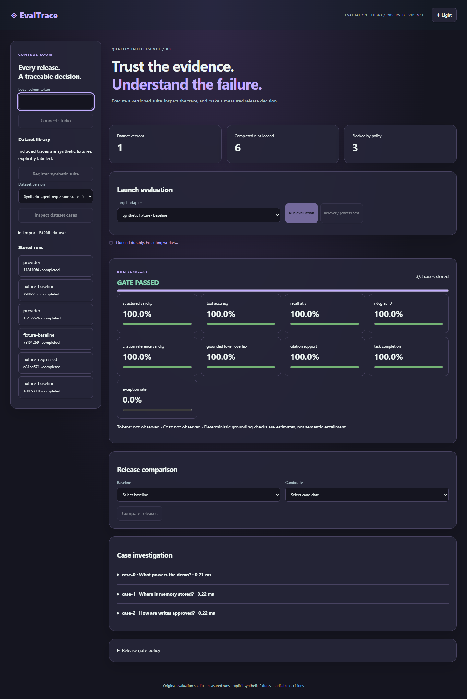
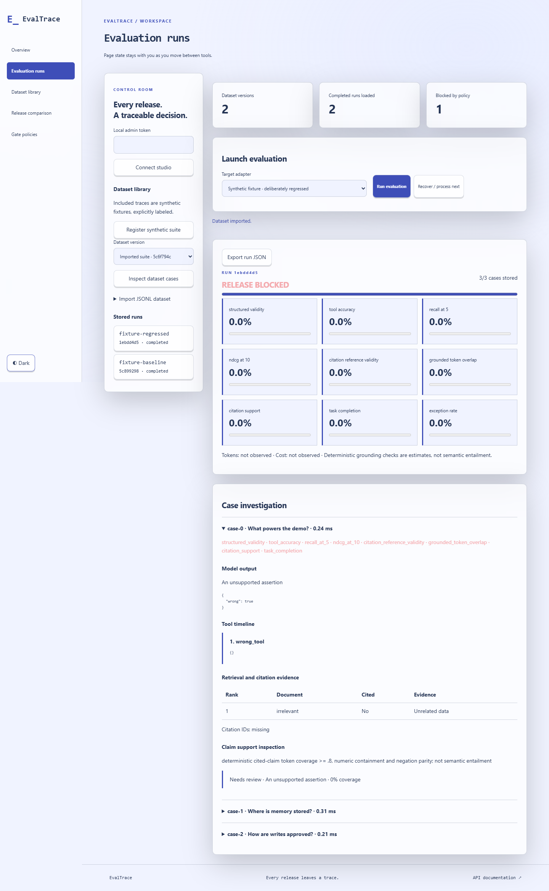
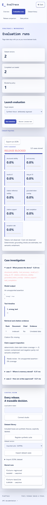
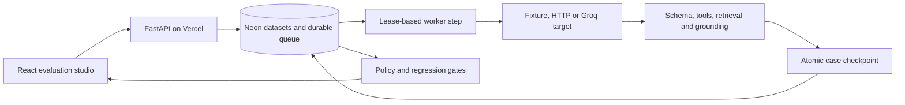
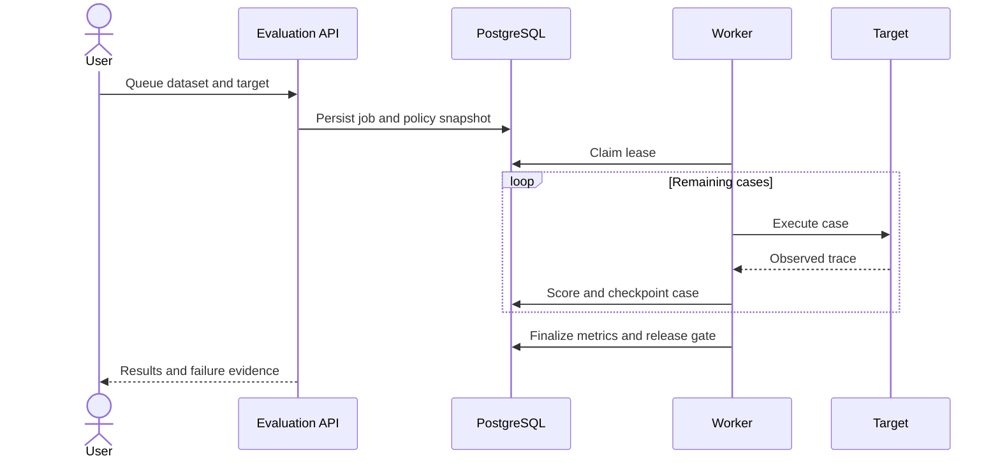

# EvalTrace

### Evaluate agent behavior. Inspect failures. Gate releases with evidence.

[](https://github.com/Kanishkar843/EvalTrace-/actions/workflows/checks.yml)

**[Live application ↗](https://evaltrace-liart.vercel.app) · [Interactive API](https://evaltrace-liart.vercel.app/docs) · [Verification report](docs/CLOUD_DELIVERY.md) · [Review PR](https://github.com/Kanishkar843/EvalTrace-/pull/1)**

EvalTrace is an evaluation studio for immutable datasets, typed traces and reproducible release decisions. PostgreSQL stores durable jobs and per-case checkpoints, while the interface exposes model outputs, tool calls, retrieval evidence, metric scores and baseline/candidate regressions.

## Interface redesign

An indigo glass control room with a persistent side rail, a dedicated landing page, Evaluation runs, Dataset library, Release comparison, and Gate policies. Export observed run results as JSON without changing their scores.



## Production preview



Captured from the deployed application. The galleries below show separately captured local test journeys.

<details>
<summary>View light theme and mobile screenshots</summary>

### Light theme — local browser test



### Mobile layout — local browser test



</details>

## Capabilities

- **Typed evaluation data:** versioned cases, JSONL import, model outputs, tool calls, retrieved documents and citations.
- **Durable execution:** 90-second leases, ownership fencing and atomic checkpoints; interrupted workers resume without duplicating completed cases.
- **Measured quality:** JSON Schema validity, exact ordered tool correctness, Recall@5, nDCG@10, citation validity and grounding heuristics.
- **Release decisions:** stored policy snapshots, failure investigation, baseline/candidate deltas and CLI quality gates.
- **Target adapters:** deterministic fixtures, bounded HTTP targets and real Groq structured-output execution.
- **Evaluation studio:** progress dashboards, trace inspection, policy editing and responsive dark/light themes.

## Scores and verification

**Evidence snapshot: 24 November 2026.** Scores describe the recorded runs, not a live uptime or quality guarantee.

### Recorded live Groq evaluation

The latest stored provider run evaluated **3 cases** with `openai/gpt-oss-20b`. **Its release gate failed.** Execution success is distinct from model-quality acceptance.

| Metric | Recorded score |
|---|---:|
| Structured-output validity | **66.67% (2/3)** |
| Tool correctness | **0%** |
| Recall@5 | **1.0000** |
| nDCG@10 | **1.0000** |
| Citation-reference validity | **100%** |
| Heuristic citation support | **100%** |
| Task completion | **100%** |
| Exception rate | **0%** |
| Observed token usage | **2,318** |
| Release gate | **FAILED** |

[Full provider result](docs/production-provider-result.json) · [Metric definitions](docs/METRICS.md)

The text-only provider target performs no retrieval tool calls and must not invent them. Its zero tool score remains visible. Grounding uses lexical, numeric and negation checks; a high score is not proof of semantic entailment. Cost was not observed and is not reported.

The deterministic baseline passes the six configured benefit gates; the deliberately regressed fixture fails. These are controlled fixtures for testing the evaluator, not production model statistics.

### Engineering checks

| Check | Verified result |
|---|---|
| Backend unit tests | **14 passed** |
| Frontend unit tests | **2 passed** |
| Real-service integration | **Passed** — PostgreSQL |
| TypeScript / ESLint / production build | **Passed** |
| Browser journeys | **Passed** — local and deployed workflows |
| Docker Compose | **Passed** — build, readiness and restart acceptance |
| Recorded GitHub acceptance run | [**Passed**](https://github.com/Kanishkar843/EvalTrace-/actions/runs/45410197303) |

[Detailed test evidence](docs/TEST_REPORT.md) · [Cloud checks and limitations](docs/CLOUD_DELIVERY.md) · [Resume-claim verification](docs/RESUME_VERIFICATION.md)

## Architecture





## Run locally

Use Python 3.12 and Node 22 for the documented local workflow. Run one project stack at a time.

```powershell
cd K:\Projects\EvalTrace
py -3.12 -m venv .venv
.\.venv\Scripts\python.exe -m pip install -r requirements.lock
npm ci --prefix frontend
npm run build --prefix frontend
$env:ADMIN_TOKEN='choose-a-local-secret'
.\.venv\Scripts\python.exe -m uvicorn app.main:app --host 127.0.0.1 --port 8002
```

Open http://127.0.0.1:8002. Connect with your operator token, register the synthetic suite, run the baseline and regressed targets, compare releases and inspect failed cases. Select the provider adapter to evaluate observed model outputs.

The API serves the compiled React frontend; `/docs` exposes OpenAPI and `/legacy` preserves the original interface. Native defaults use SQLite for an explicit local demo. To use PostgreSQL, configure `DATABASE_URL`, then run `python -m alembic upgrade head`. For frontend development, use `npm run dev --prefix frontend` with the API running.

## Configuration

| Variable | Purpose |
|---|---|
| `DATABASE_URL` | PostgreSQL URL; defaults to local SQLite demo mode |
| `ADMIN_TOKEN` | Required operator bearer token |
| `LOCAL_TARGET_URL` | Loopback HTTP typed-trace endpoint |
| `REMOTE_TARGET_URL` / `REMOTE_TARGET_TOKEN` | Configured HTTPS endpoint and optional credential |
| `LLM_BASE_URL` / `LLM_MODEL` / `LLM_API_KEY` | Provider endpoint, model and server-side secret |
| `POSTGRES_PASSWORD` / `APP_PORT` | Compose database secret / loopback port (8002) |

Keep credentials in environment variables or ignored `.env` files. Never put provider keys, database credentials or operator tokens in frontend build variables or Git.

## Deployment

The live frontend and backend share one Vercel project. `vercel.json` builds React, copies assets to `public`, and deploys the FastAPI entrypoint. Neon provides PostgreSQL; the configured integrations use free plans.

```powershell
# From the linked project, after configuring production secrets and migrations:
vercel deploy --prod --scope kanishkar843s-projects
```

For local containers, configure the required `.env` values, then:

```powershell
docker compose up --build -d --wait
docker compose down
```

Omit `-v` when stopping containers to retain database data. Windows virtual environments cannot be reused inside WSL; use containers or create a Linux environment. See [Windows/Docker setup](docs/DEPLOYMENT.md) and [Vercel configuration](docs/CLOUD_DELIVERY.md).

For a continuous local/container worker, use `python -m app.worker` or `docker compose --profile worker up -d`. The deployed free-tier workflow uses the authenticated worker-step control instead.

## Reproduce the checks

```powershell
.\.venv\Scripts\python.exe -m pytest -q tests
npm run typecheck --prefix frontend
npm run lint --prefix frontend
npm test --prefix frontend
npm run build --prefix frontend
.\.venv\Scripts\python.exe -m pytest -q integration
.\.venv\Scripts\python.exe tests/browser_journey.py
```

The integration suite requires an isolated real PostgreSQL `TEST_DATABASE_URL`; it never substitutes SQLite. The local browser harness owns a temporary fixture server. Production browser evidence is recorded separately in the cloud report.

`python -m app.cli --target fixture-baseline` exits 0; `--target fixture-regressed` exits 1. A failing gate is expected behavior for the regressed target. `--baseline RUN_ID --candidate RUN_ID` also checks relative regressions.

## Known limits

- The recorded Groq target failed its quality gate; it is not certified as a passing release target.
- Vercel executes authenticated bounded worker steps. An unattended continuous worker is not configured there.
- Real PostgreSQL acceptance tested killed-worker recovery and concurrent ownership; this is not a production reliability SLA.
- Grounding heuristics are inspectable estimates, not definitive hallucination detection.
- Operator authorization uses a shared bearer secret; this is not a multi-tenant identity system.

## Documentation and provenance

[Architecture](docs/ARCHITECTURE.md) · [Database schema](docs/DATABASE_ERD.md) · [API reference](docs/API_REFERENCE.md) · [Environment](docs/ENVIRONMENT_REPORT.md) · [Security](docs/SECURITY.md) · [Dependencies and attribution](docs/DEPENDENCIES_AND_ATTRIBUTION.md) · [Original specification](docs/MASTER_PROMPT.md)

First-party application code, interface designs and fixtures are original to this project. Dependencies and model artifacts retain their third-party notices. No first-party project license has been selected.

Development is published on `feat/durable-evaluation-react` through [PR #1](https://github.com/Kanishkar843/EvalTrace-/pull/1), preserving existing `main` history. Deployment status, software acceptance and evaluated-model quality are reported separately.
