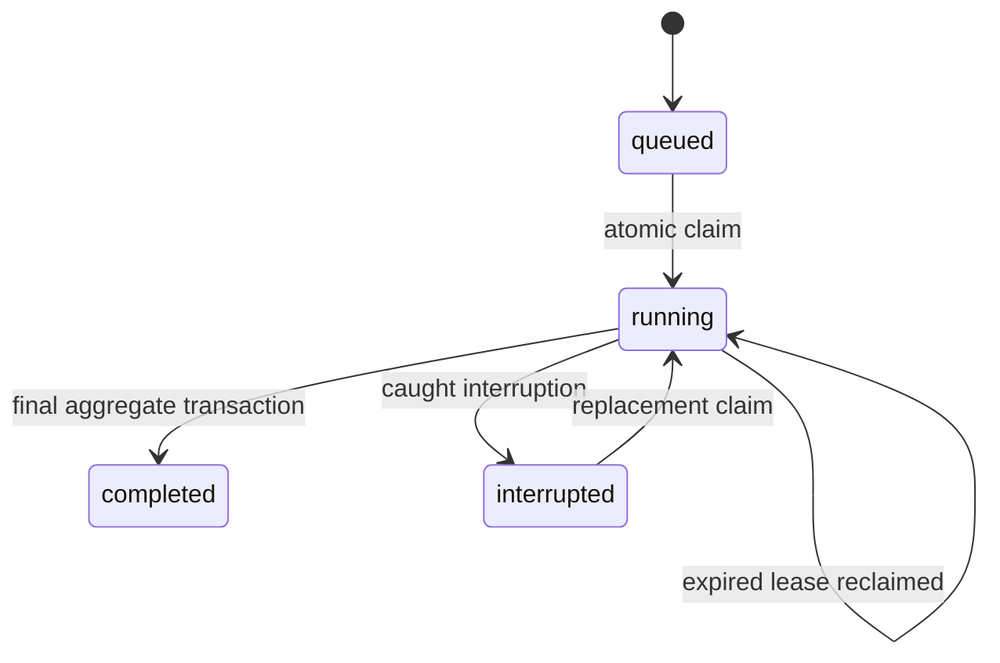
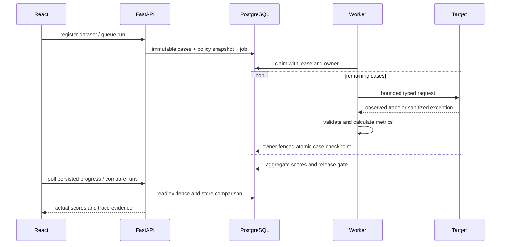

# Architecture and recovery

The React bundle is served by FastAPI on the same origin. Typed dataset registration creates immutable content-hash versions. Queue insertion snapshots policy before a worker claims the job. PostgreSQL uses `FOR UPDATE SKIP LOCKED`; an atomic conditional update is also checked. A random owner ID fences checkpoint/final writes against an expired worker. Each case renews a 90-second lease; bounded adapter attempts last at most roughly 31 seconds before evaluation. Process death leaves the job recoverable after lease expiry. Completed cases are read from PostgreSQL and skipped on recovery.

Tradeoffs: execution is at least once for an in-flight external call; owner fencing prevents duplicate stored cases, but it cannot undo remote side effects. Targets should be read-only/idempotent. Fixture results are reproducible; hosted model outputs may vary. The queue and API are appropriate for the bounded local studio, not a claim of production-scale reliability. The worker profile is optional; authenticated API stepping uses the same durable engine.
