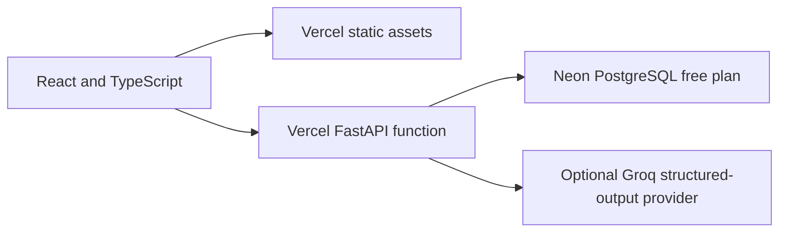

# Cloud delivery — 2026-11-24

Live application: https://evaltrace-liart.vercel.app

Production uses Neon PostgreSQL for immutable datasets, traces, durable queues and checkpoints. Authenticated worker steps execute queued jobs within bounded requests. Groq GPT-OSS 20B is available as an evaluation target; a live target can fail quality gates without being hidden or relabeled as a passing fixture.

## Architecture



## Verified evidence

- Public health/readiness: HTTP 200 with PostgreSQL. Private dataset endpoint without token: HTTP 401.
- Dataset registration, baseline execution, regressed execution and comparison: passed. Regressed target was correctly blocked.
- Durable production enqueue and authenticated worker step: passed.
- Live Groq target execution: completed with observed results; see production-provider-result.json. Do not interpret execution success as passing the target's quality gate.
- The initial provider test failed structured validity because the adapter omitted the case output schema. The adapter now supplies that schema, with a regression assertion. Tool correctness still depends on actual tool calls; this text-only adapter must not fabricate calls.
- Backend: 14 tests passed; updated adapter tests: 2 passed; correctness lint passed. A Starlette HTTPX deprecation warning remains.
- Vercel does not run the persistent local worker process. Use the authenticated UI worker step for this free-tier deployment; unattended continuous scheduling is not configured.

All three applications passed actual Chrome production smoke journeys. Screenshots in docs/assets/production-desktop.png were captured from live deployments with secret fields cleared. Earlier local/Docker/CI evidence remains in TEST_REPORT.md; those checks are not relabeled as cloud checks.

The initial production browser harness expected DeltaIndex search results before submitting a query; this assertion failed. The harness now submits Search, and the rerun passed. Initial Vercel builds required flattening requirements.txt rather than including the runtime lock with -r.

## Reproduce deployment

Use Node, Python 3.12, authenticated Vercel CLI and the existing linked project. Never commit .env files or .vercel metadata.

```powershell
npm ci --prefix frontend
npm run build --prefix frontend
# Apply Alembic against the selected PostgreSQL database before deploying.
.\.venv\Scripts\python.exe -m alembic upgrade head
vercel deploy --prod --scope kanishkar843s-projects
```

vercel.json builds React and copies static assets into public; app/main.py is the FastAPI entrypoint. DATABASE_URL accepts Neon postgres/postgresql URLs and selects the psycopg driver. requirements.txt pins cloud runtime dependencies; requirements.lock retains native development dependencies.

Neon resources use free_v3; Upstash uses free with automatic paid upgrade disabled. No paid plan was enabled. Provider and database credentials remain in Vercel environment variables and ignored local files. Account quota availability is not a performance guarantee.

## Access and limitations

Administrative controls require ADMIN_TOKEN. The owner can retrieve the local value from the ignored .env.production.local file; never publish that token or put it in frontend build variables. This is a single-operator workspace, not multi-tenant account authentication.

Latest provider rerun after the schema-input fix: 2,318 observed tokens; structured validity 2/3, tool accuracy 0, retrieval/citation/task metrics 1.0, exception rate 0. The quality gate remains failed. This provider target is not certified for release; the studio accurately preserves and displays the failure.
