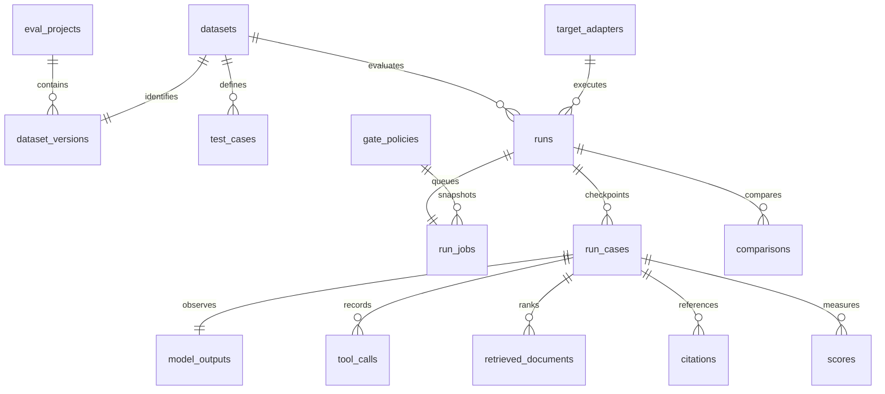

# Database schema

Alembic 0001 freezes the original datasets/runs/gate_policies tables. 0002 adds durable and normalized evidence entities without deleting legacy rows. Datasets retain their original serialized cases for backward compatibility; registration also fills dataset_versions/test_cases. New runs always store normalized checkpoints.

Dataset/run/job/case foreign keys are enforced where declared in schema.py. Output/tool/document/citation/score links use composite run/case identity and are written in the same transaction; the diagram includes logical links, not a claim that every edge has a database constraint. run_cases has primary key `(run_id,case_id)` and ordinal ordering. run_jobs stores state, owner, lease_until, attempts and immutable policy JSON. The mutable gate_policies singleton only affects future queue insertions. UUID run IDs and SHA-256 dataset content hashes are separate identities. UTC timestamps and metric/prompt/model metadata support investigation. Destructive downgrades intentionally require restoring a backup.
