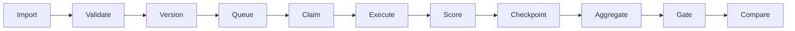

# Workflows

1. Connect with operator token; register the synthetic suite or import typed JSONL.
2. Inspect immutable cases and select a dataset version/adapter.
3. Queue a durable job; process it from the UI or continuous worker.
4. Poll actual stored case progress; inspect scorecards and gate result.
5. Compare completed runs with matching content/metric versions.
6. Open a failed case to inspect structured output, tool arguments, retrieval ranking, missing citations and claim-support evidence.
7. Edit future-run gate floors; retain past policy snapshots.

A killed worker resumes after lease expiry, skipping committed cases. A failed target becomes a sanitized exception trace and fails appropriate metrics; no fabricated successful output replaces it.
