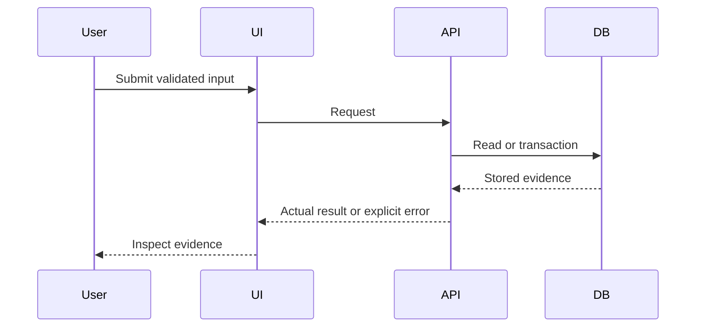

# Workflows

1. Validated immutable dataset versions using SHA-256 content identity.
2. JSON Schema validity, exact tool name/arguments, Recall@5 and nDCG@10.
3. Citation-reference validity and explicitly heuristic grounded-token overlap.
4. Fixture and restricted loopback HTTP target adapters; actual measured case duration.
5. Stored runs, policy snapshots, baseline/candidate comparison and CLI pass/block exit status.

The full acceptance workflow remains in MASTER_PROMPT.md. A native success does not establish Docker, cloud or provider success.
